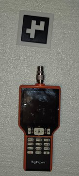
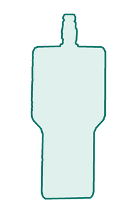
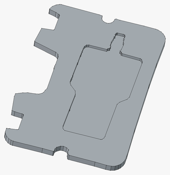

# pocket

**Photograph your gear, get a 3D-printed case insert that fits it exactly.**

Cheap hard cases come full of generic foam. This project replaces the foam with a printed insert that has a pocket shaped to the object. Here, a $7.99 pistol case becomes a case for a handheld antenna analyzer.

```
Photo  →  Python script  →  DXF outline  →  FreeCAD  →  Slicer  →  Print
```

<table>
  <tr>
    <td align="center"></td>
    <td align="center"></td>
    <td align="center"></td>
  </tr>
  <tr>
    <td align="center"><sub>1. Photo with marker</sub></td>
    <td align="center"><sub>3. DXF outline</sub></td>
    <td align="center"><sub>4. Pocket in FreeCAD</sub></td>
  </tr>
</table>

1. **Photo:** lay the object next to a printed ArUco marker and take one picture from above.
2. **Python script:** the marker gives true scale and corrects a tilted camera. The script traces the object's outline.
3. **DXF outline:** you get an exact outline plus one with 0.4 mm clearance, ready for any CAD program.
4. **FreeCAD:** pad the case's foam outline into a plate and cut the object's outline out of it as a pocket.
5. **Slicer:** if the insert is bigger than the build plate, split it (Bambu Studio's cut tool).
6. **Print** it and drop it in the case.

No ruler, no manual measuring, no redrawing. See [`photo_to_printed_insert.pdf`](photo_to_printed_insert.pdf) for an illustrated six-page overview of the worked example.

## How it works

Scale comes from a reference of known size lying in the photo, ideally a printed **ArUco marker**, which is found automatically and also lets the script correct a tilted camera. A credit card, dollar bill, half banana (100 × 40 mm), any known rectangle, or a ruler also work.

The full step-by-step guide is in [`photo-to-freecad-nest.md`](photo-to-freecad-nest.md).

### Workflow

1. **Print a marker.** Use the ready-made 60 mm marker in `marker/` (paper PDF, single-STL with a filament change at Z = 1 mm, or two-material 3MF), or generate one with the scripts below. Measure its black square with calipers.
2. **Take the photo.** Object and marker flat on a plain, high-contrast background, shot straight down from as far away as practical.
3. **Trace it.**
   ```
   python scripts/photo_to_outline.py my_photo.jpg --aruco-size 60.2
   ```
   Output goes to `out/`: an exact outline, a clearance outline (grown by 0.4 mm per side by default) as DXF and SVG, and an overlay image to check the trace.
4. **Check it.** Look at the overlay, compare the reported size with calipers, and print a one-layer test of the clearance outline.
5. **Model it.** Import the clearance DXF into FreeCAD, convert it to a sketch, and pocket it out of a block in Part Design.

### Command-line options

```
python scripts/photo_to_outline.py PHOTO [options]
```

Every option overrides a default in the script's `SETTINGS` block, so you can also change the defaults there. For a dark object on a light background, `--aruco-size` is usually the only option you need. Pixel boxes (`x0,y0,x1,y1`) are in the original, full-resolution photo.

| Option | Default | What it does |
|---|---|---|
| `PHOTO` | `photo.jpg` | input photo |
| **Output** | | |
| `--name NAME` | photo file name | prefix for the output files |
| `--out DIR` | `./out/` | output folder |
| `--clearance MM` | `0.4` | gap added per side for the clearance outline (0.3 to 0.5 mm suits FDM printing) |
| `--simplify MM` | `0.4` | point-reduction tolerance; larger values give smoother, simpler outlines |
| **Scale reference** | | |
| `--ref REF` | `aruco` | `aruco`, `half_banana`, `credit_card`, `dollar_bill`, `ruler`, or any rectangle as `LONGxSHORT` in mm, e.g. `100x40` |
| `--aruco-size MM` | `60.0` | measured side of the marker's outer black square. Always set it to what your calipers say |
| `--aruco-id N` | largest found | which marker to use when the photo has several |
| `--no-rectify` | off | don't straighten perspective using the marker |
| `--ref-box x0,y0,x1,y1` | none | box around a rectangle reference (needed for any `--ref` other than `aruco`) |
| `--ref-lighter` | off | the rectangle reference is lighter than the background |
| **Finding the object** | | |
| `--keep-box x0,y0,x1,y1` | whole photo | only look for the object inside this box. Use it if something else dark is in frame |
| `--dark-thresh N` | automatic (Otsu) | gray level (0 to 255) below which a pixel counts as object |
| `--light-box x0,y0,x1,y1` | none | box around light or shiny parts (such as a metal connector) that the dark threshold misses |
| `--paper-patch x0,y0,x1,y1` | automatic | patch of clean background, used with `--light-box` |
| `--flatten-top` | off | replace a narrow protrusion at the top (such as a connector) with a plain rectangle |

The `ruler` reference has no command-line options: set its tick positions (`TICK_*`) in the script. See Appendix B of the [guide](photo-to-freecad-nest.md).

Example: the antenna analyzer from the worked example, with a shiny connector and a cluttered edge to avoid:

```
python scripts/photo_to_outline.py analyzer.jpg --aruco-size 60.2 --keep-box 300,0,1500,2040 \
  --paper-patch 300,300,500,700 --light-box 800,150,1130,540 --dark-thresh 95 --flatten-top
```

(`\` continues the line on macOS and Linux. In PowerShell use a backtick, in `cmd` use `^`, or put it all on one line.)

## Setup

Python 3.10+:

```
python -m venv venv
venv\Scripts\activate          # Windows
source venv/bin/activate       # macOS / Linux
pip install -r requirements.txt
```

## Repository layout

| Path | Contents |
|---|---|
| `photo_to_printed_insert.pdf` | illustrated overview of the process and the worked example |
| `docs/img/` | README thumbnails |
| `photo-to-freecad-nest.md` | the full guide: photography, calibration, script flags, FreeCAD steps, known limits |
| `scripts/photo_to_outline.py` | photo → scaled, straightened, simplified DXF + SVG (run with `-h` for all flags) |
| `scripts/make_aruco_marker.py` | printable marker sheet (PDF) |
| `scripts/make_aruco_stl.py` | 3D-printable marker, single STL for a filament-change print |
| `scripts/make_aruco_3mf.py` | 3D-printable marker, two-material 3MF |
| `scripts/strip_metadata.py` | losslessly removes EXIF/GPS/XMP metadata from JPEGs, in place |
| `scripts/gps_check.py` | reports images that contain GPS location data |
| `.githooks/pre-commit` | blocks commits of images with GPS data (see below) |
| `marker/` | the 60 mm `DICT_4X4_50` id 7 marker, ready to print |
| `match_outline/` | finished outline from the worked example (DXF, SVG, preview) |
| `match.FCStd` | plate shaped to match the case's original foam piece |
| `mills_insert.FCStd` | insert for the Mills Fleet Farm pistol case |
| `mpocket.FCStd` | the pocket assembly: the analyzer outline cut out of the plate |
| `mpocket-AssemblyCut.3mf` | sliceable export of the pocket |
| `20261025_*.jpg` | source photos |

Generated output in `out/`, the virtual environment and FreeCAD backup files (`*.FCBak`) are not tracked.

## Photo privacy

Phone photos usually embed the GPS location where they were taken. Strip it before committing:

```
python scripts/strip_metadata.py my_photo.jpg
```

A pre-commit hook refuses to commit JPEG or PNG files that still contain location data. Git does not enable repository hooks automatically, so turn it on once per clone:

```
git config core.hooksPath .githooks
```

## Requirements

- Python with `opencv-python` (4.7+ or 5.x, with the `aruco` module), `numpy`, `scipy`, `shapely`, `ezdxf`, `pillow`
- [FreeCAD](https://www.freecad.org/) 1.0 or later
